# Quản lý đặt vé xem phim tại rạp

Bài tập lớn lập trình C, đề tài số 7 trong Phụ lục A (lĩnh vực Giải trí). Chương trình chạy trên console Windows, quản lý lịch chiếu, sơ đồ ghế theo từng suất, đặt và hủy vé, thống kê doanh thu, lưu và đọc dữ liệu từ tệp.

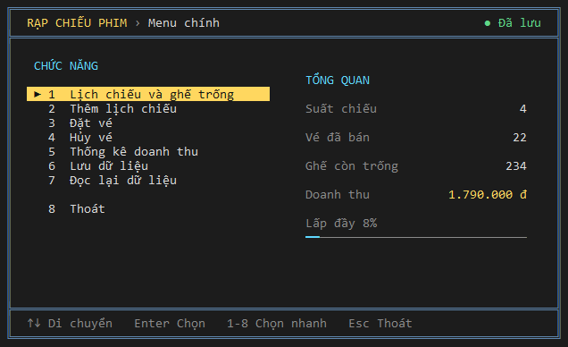

## Mục lục

- [Đáp ứng yêu cầu của đề](#đáp-ứng-yêu-cầu-của-đề)
- [Cài đặt và chạy](#cài-đặt-và-chạy)
- [Giải thích từng màn hình](#giải-thích-từng-màn-hình)
- [Công thức tính toán](#công-thức-tính-toán)
- [Thuật toán đệ quy](#thuật-toán-đệ-quy)
- [Cấu trúc dữ liệu](#cấu-trúc-dữ-liệu)
- [Định dạng tệp dữ liệu](#định-dạng-tệp-dữ-liệu)
- [Quy tắc kiểm tra dữ liệu](#quy-tắc-kiểm-tra-dữ-liệu)
- [Tổ chức mã nguồn](#tổ-chức-mã-nguồn)
- [Kiểm thử](#kiểm-thử)
- [Giới hạn và giả định](#giới-hạn-và-giả-định)

## Đáp ứng yêu cầu của đề

| Yêu cầu | Cách thực hiện | Vị trí trong mã nguồn |
|---|---|---|
| Thêm lịch chiếu | Form nhập, kiểm tra từng trường, chặn trùng mã và trùng giờ cùng phòng | [`sc_them`](src/suatchieu.c#L27) |
| Đặt vé theo sơ đồ ghế | Chọn ghế trên sơ đồ, một ghế lỗi thì không đặt ghế nào | [`ve_dat_nhieu`](src/ve.c#L51) |
| Hủy vé | Xóa nút tương ứng khỏi danh sách ghế đã đặt | [`ve_huy`](src/ve.c#L82) |
| Kiểm tra ghế trống | Đếm ghế trống và tìm dãy ghế liền kề | [`ve_tim_day_ghe`](src/ve.c#L112) |
| Thống kê doanh thu theo phim/suất | Tính lại từ các vé đang được đặt | [`tk_doanh_thu_suat`](src/thongke.c#L10), [`tk_theo_phim`](src/thongke.c#L30) |
| Lưu/đọc tệp | Tệp văn bản UTF-8 có kiểm tra định dạng | [`tep_luu`](src/tepdulieu.c#L22), [`tep_doc`](src/tepdulieu.c#L101) |
| Struct và danh sách liên kết | `SuatChieu` liên kết danh sách `GheDat` | [`mohinh.h`](src/mohinh.h) |
| Hàm và con trỏ | Tách hàm theo chức năng; truyền `SuatChieu *` và `SuatChieu **` | Toàn bộ `src/` |
| Đệ quy | Kiểm tra dãy ghế trống liền kề | [`ve_day_trong`](src/ve.c#L106) |
| Giao diện menu | Menu chọn bằng phím mũi tên hoặc phím số | [`manhinh.c`](src/manhinh.c) |

## Cài đặt và chạy

**Yêu cầu:** Windows 10 trở lên và một trong hai trình biên dịch C: Visual Studio Build Tools hoặc MinGW-w64 (`gcc`). `build.bat` tự tìm trình biên dịch.

```powershell
.\build.bat                    # biên dịch
.\rapchieuphim_console.exe     # chạy chương trình
.\build.bat test               # chạy kiểm thử tự động
```

Cửa sổ console cần rộng ít nhất 80 cột và cao 25 dòng; nếu nhỏ hơn, chương trình sẽ yêu cầu phóng to. Tệp [`data.txt`](data.txt) có sẵn dữ liệu mẫu hư cấu gồm 4 suất chiếu và 22 vé, được đọc từ thư mục đang chạy chương trình.

## Giải thích từng màn hình

Các ví dụ dưới đây dùng dữ liệu mẫu. Mọi màn hình đều có dòng phím tắt ở đáy khung và trạng thái ở góc trên bên phải: `● Đã lưu` hoặc `● Chưa lưu`.

### 1. Menu chính


Cột trái là 8 chức năng, chọn bằng `↑` `↓` rồi `Enter`, hoặc nhấn phím số `1` đến `8`. `Esc` tương đương chọn Thoát.

Cột phải là phần tổng quan, tính lại mỗi lần vẽ màn hình:

| Chỉ số | Giá trị mẫu | Cách tính |
|---|---|---|
| Suất chiếu | 4 | Đếm số nút trong danh sách suất chiếu |
| Vé đã bán | 22 | 5 + 7 + 8 + 2 |
| Ghế còn trống | 234 | 256 − 22 |
| Doanh thu | 1.790.000 đ | Xem [công thức doanh thu](#doanh-thu) |
| Lấp đầy | 8% | 22 × 100 / 256, chia nguyên |

### 2. Lịch chiếu

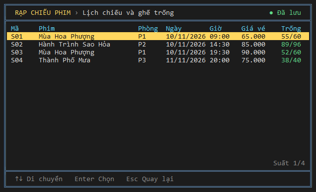

Danh sách suất chiếu luôn được sắp theo thời gian. Cột **Trống** có dạng `ghế trống/tổng ghế`, ví dụ S01 có 6 hàng × 10 cột = 60 ghế và 5 vé đã đặt nên hiện `55/60`. Dùng `↑` `↓`, `PgUp` `PgDn`, `Home` `End` để di chuyển và `Enter` để mở sơ đồ ghế. Danh sách này cũng dùng để chọn suất khi đặt và hủy vé.

### 3. Sơ đồ ghế và kiểm tra ghế trống

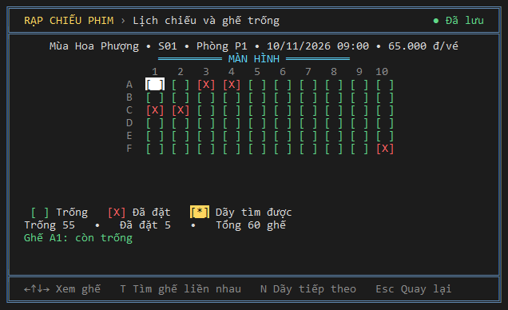

Sơ đồ không lưu thành ma trận. Mỗi ô được vẽ bằng cách duyệt danh sách ghế đã đặt của suất đó.

| Ký hiệu | Ý nghĩa |
|---|---|
| `[ ]` xanh lá | Ghế trống |
| `[X]` đỏ | Ghế đã đặt |
| `[*]` vàng | Ghế đang chọn hoặc thuộc dãy vừa tìm được |
| Nền sáng | Vị trí con trỏ |

Mã ghế gồm chữ cái hàng và số cột: `A5` là hàng A, cột 5. Dùng các phím mũi tên để xem trạng thái từng ghế.

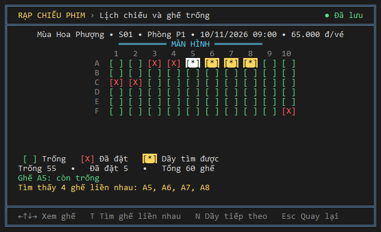

Nhấn `T` rồi nhập số ghế để tìm dãy ghế trống liền nhau, ví dụ 4 ghế cho kết quả `A5, A6, A7, A8`. Nhấn `N` để xem dãy tiếp theo. Cách hoạt động được giải thích ở phần [thuật toán đệ quy](#thuật-toán-đệ-quy).

### 4. Thêm lịch chiếu

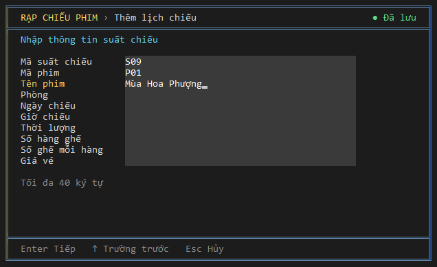

Nhập lần lượt 10 trường. `Enter` kiểm tra rồi sang trường sau, `↑` về trường trước, `Esc` hủy. Dòng gợi ý phía dưới mô tả định dạng của trường đang nhập. Nếu mã phim đã tồn tại, tên phim được tự điền để thống kê không tách một phim thành hai.

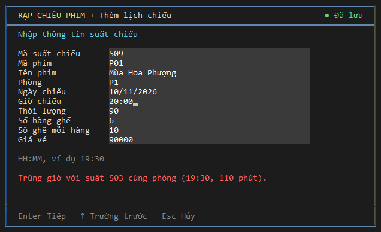

Khi nhập xong, chương trình kiểm tra trùng lịch. Trong ảnh, suất mới bị từ chối vì trùng phòng P1 với S03; cách tính nằm ở [công thức trùng lịch](#trùng-lịch-chiếu).

### 5. Đặt vé

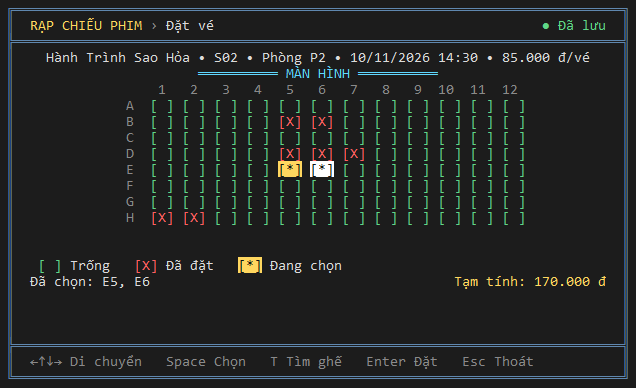

Bước 1: chọn suất. Bước 2: di chuyển đến ghế và nhấn `Space` để chọn hoặc bỏ chọn; nhấn `T` để chương trình tự chọn một dãy liền nhau. Ghế đã đặt không chọn được. **Tạm tính** được cập nhật theo số ghế: 2 × 85.000 = 170.000 đ.

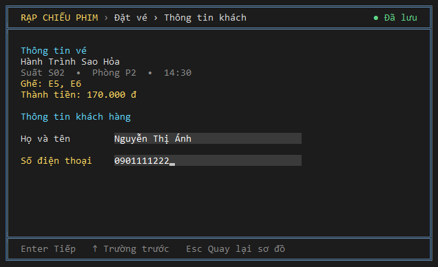

Bước 3: nhấn `Enter` rồi nhập họ tên và số điện thoại. Tiếng Việt có dấu được hỗ trợ.

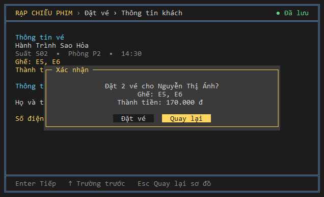

Bước 4: xác nhận. Nút mặc định là **Quay lại** để tránh đặt nhầm; dùng `←` `→` để đổi nút và `Enter` để chọn.

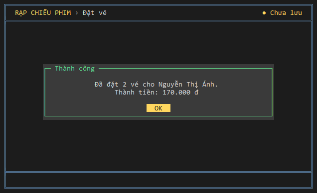

Vé được thêm vào danh sách trong bộ nhớ, nên trạng thái chuyển sang `● Chưa lưu`. Trước khi thêm, chương trình kiểm tra toàn bộ các ghế: một ghế không hợp lệ thì không ghế nào được đặt.

### 6. Hủy vé

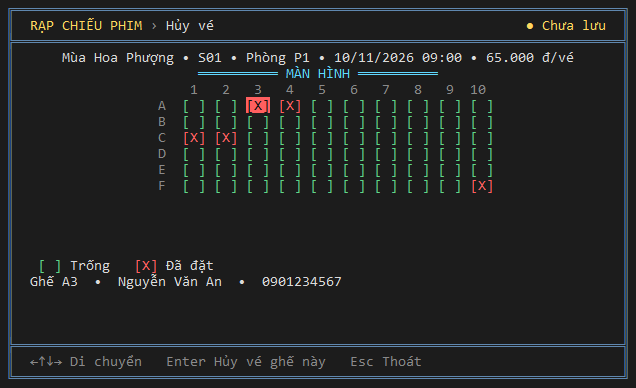

Sau khi chọn suất, con trỏ tự đặt ở ghế đã đặt đầu tiên và màn hình hiện thông tin khách của ghế đó. Nhấn `Enter` hoặc `Space` để hủy. Ghế chưa có người đặt sẽ được báo lỗi.

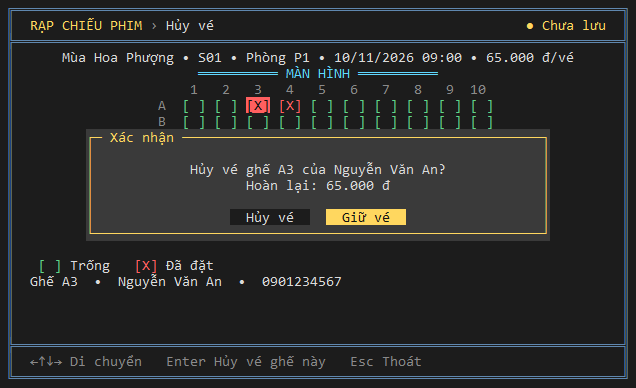

Nút mặc định là **Giữ vé**. Hủy vé xóa nút khỏi danh sách liên kết, vì vậy doanh thu tự giảm mà không cần biến riêng.

### 7. Thống kê doanh thu

Dùng `←` `→` để đổi bảng và `↑` `↓` để cuộn.

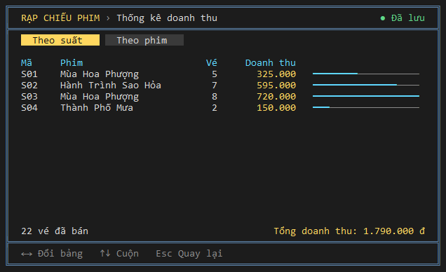

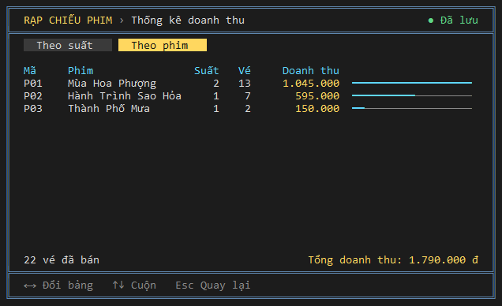

Bảng theo suất giữ thứ tự thời gian; bảng theo phim xếp doanh thu giảm dần. Độ dài thanh ngang được tính theo [công thức thanh biểu đồ](#thanh-biểu-đồ).

### 8. Lưu, đọc lại và thoát

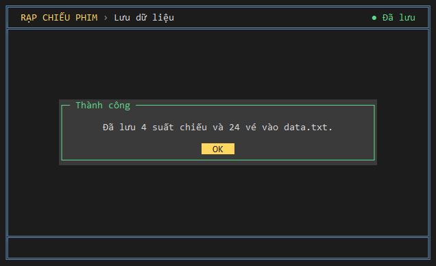

**Lưu dữ liệu** ghi toàn bộ suất chiếu và vé vào `data.txt`. Ảnh trên được chụp sau khi đặt thêm 2 vé nên tổng là 24 vé. **Đọc lại dữ liệu** thay dữ liệu đang mở bằng nội dung tệp; nếu còn thay đổi chưa lưu, chương trình sẽ hỏi trước.

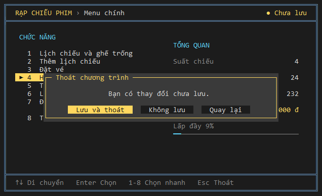

Khi thoát mà chưa lưu, có ba lựa chọn: **Lưu và thoát**, **Không lưu** và **Quay lại**.

## Công thức tính toán

### Số ghế

```text
Tổng ghế của suất = số hàng × số ghế mỗi hàng
Ghế trống         = tổng ghế − số vé đã đặt
Tỷ lệ lấp đầy (%) = tổng vé đã đặt × 100 / tổng ghế toàn bộ suất   (chia nguyên)
```

Số vé đã đặt có được bằng cách đếm số nút trong `dsGhe`, không lưu thành biến riêng, nên không thể lệch so với danh sách.

### Doanh thu

```text
Doanh thu một suất = số vé đang đặt × giá vé của suất
Doanh thu một phim = tổng doanh thu các suất có cùng mã phim
Tổng doanh thu     = tổng doanh thu mọi suất
Tạm tính khi đặt   = số ghế đang chọn × giá vé
```

Tính với dữ liệu mẫu:

| Suất | Phim | Số vé | Giá vé | Doanh thu |
|---|---|---:|---:|---:|
| S01 | P01 Mùa Hoa Phượng | 5 | 65.000 | 325.000 |
| S02 | P02 Hành Trình Sao Hỏa | 7 | 85.000 | 595.000 |
| S03 | P01 Mùa Hoa Phượng | 8 | 90.000 | 720.000 |
| S04 | P03 Thành Phố Mưa | 2 | 75.000 | 150.000 |
| **Tổng** | | **22** | | **1.790.000** |

Theo phim, P01 = 325.000 + 720.000 = 1.045.000 đ, gồm 2 suất và 13 vé. Doanh thu lưu bằng `long long` để không tràn số khi cộng dồn.

### Thanh biểu đồ

```text
Số ô tô màu = giá trị × độ rộng thanh / giá trị lớn nhất   (chia nguyên)
Nếu giá trị > 0 mà kết quả bằng 0 thì tô 1 ô
```

Bảng thống kê có thanh rộng 19 ô. Giá trị lớn nhất của bảng theo suất là 720.000, nên S01 được 325.000 × 19 / 720.000 = 8 ô và S03 được đủ 19 ô.

### Trùng lịch chiếu

Mỗi suất chiếm khoảng thời gian `[bắt đầu, kết thúc)` với `kết thúc = bắt đầu + thời lượng`. Hai suất A và B trùng lịch khi:

```text
A.phòng = B.phòng  VÀ  A.bắt đầu < B.kết thúc  VÀ  B.bắt đầu < A.kết thúc
```

Suất sau bắt đầu đúng lúc suất trước kết thúc thì không bị tính là trùng.

Để so sánh được suất qua đêm, ngày giờ được đổi sang số phút tuyệt đối trong [`nl_phut`](src/nhaplieu.c#L50), với `/` là phép chia nguyên:

```text
y = năm, m = tháng, d = ngày
Nếu m ≤ 2 thì y = y − 1

era = y / 400
yoe = y − era × 400
doy = (153 × (m − 3 nếu m > 2, m + 9 nếu m ≤ 2) + 2) / 5 + d − 1
doe = yoe × 365 + yoe / 4 − yoe / 100 + doy
Số ngày = era × 146097 + doe
Số phút = Số ngày × 1440 + giờ × 60 + phút
```

Công thức coi tháng 3 là đầu năm, nên ngày 29/02 của năm nhuận rơi vào cuối năm và không làm lệch các tháng khác.

Ví dụ ở [màn hình báo trùng lịch](#4-thêm-lịch-chiếu), ngày 10/11/2026:

```text
era = 5, yoe = 26
doy = (153 × 8 + 2) / 5 + 10 − 1 = 254
doe = 26 × 365 + 6 − 0 + 254 = 9750
Số ngày = 5 × 146097 + 9750 = 740235

S03 (19:30, 110 phút):   bắt đầu = 1065939570, kết thúc = 1065939680
Suất mới (20:00, 90 phút): bắt đầu = 1065939600, kết thúc = 1065939690

1065939570 < 1065939690  và  1065939600 < 1065939680  →  trùng lịch
```

### Năm nhuận

```text
Năm nhuận = (năm chia hết cho 4 VÀ không chia hết cho 100) HOẶC năm chia hết cho 400
```

Năm nhuận được dùng khi kiểm tra ngày nhập: 29/02/2028 hợp lệ, còn 29/02/2027 bị từ chối.

## Thuật toán đệ quy

### Kiểm tra k ghế liền nhau: `ve_day_trong`

```c
int ve_day_trong(const SuatChieu *s, int hang, int cot, int k) {
    if (k == 0) return 1;                                                  /* điểm dừng: đã đủ ghế */
    if (!vi_tri_hop_le(s, hang, cot) || ve_ghe_da_dat(s, hang, cot)) return 0; /* điểm dừng: hết hàng hoặc ghế đã đặt */
    return ve_day_trong(s, hang, cot + 1, k - 1);                          /* xét ghế kế tiếp, còn thiếu k − 1 ghế */
}
```

### Tìm dãy đầu tiên: `ve_tim_day_ghe`

```c
int ve_tim_day_ghe(const SuatChieu *s, int hang, int cot, int k, int *ra_hang, int *ra_cot) {
    if (k <= 0 || k > s->soCot || hang >= s->soHang) return 0;             /* không thể tìm hoặc đã hết phòng */
    if (cot + k - 1 > s->soCot) return ve_tim_day_ghe(s, hang + 1, 1, k, ra_hang, ra_cot); /* không đủ chỗ: sang hàng sau */
    if (ve_day_trong(s, hang, cot, k)) {                                   /* tìm thấy */
        *ra_hang = hang;
        *ra_cot = cot;
        return 1;
    }
    return ve_tim_day_ghe(s, hang, cot + 1, k, ra_hang, ra_cot);           /* thử từ ghế kế tiếp */
}
```

### Ví dụ chạy với k = 4 trên suất S01

Hàng A của S01 có ghế A3 và A4 đã đặt.

| Bước | Vị trí bắt đầu | Kết quả |
|---|---|---|
| 1 | A1 | A1, A2 trống, gặp A3 đã đặt → không đạt |
| 2 | A2 | A2 trống, gặp A3 đã đặt → không đạt |
| 3 | A3 | A3 đã đặt → không đạt |
| 4 | A4 | A4 đã đặt → không đạt |
| 5 | A5 | A5, A6, A7, A8 đều trống, `k` giảm về 0 → **tìm thấy** |

Nhấn `N` sẽ bắt đầu tìm từ A6 và cho kết quả A6 đến A9. Nếu vị trí bắt đầu không còn đủ chỗ, ví dụ A8 với `k = 4` vì 8 + 4 − 1 = 11 > 10, việc tìm sẽ chuyển sang hàng B.

### Độ phức tạp

Với `V` là số ghế đã đặt, `H` là số hàng, `C` là số cột:

- `ve_ghe_da_dat` duyệt danh sách nên tốn O(V).
- `ve_day_trong` tốn O(k × V).
- `ve_tim_day_ghe` trong trường hợp xấu nhất tốn O(H × C × k × V).
- Phòng lớn nhất có 10 × 15 ghế, nên độ sâu đệ quy chỉ khoảng 160 lời gọi và không có nguy cơ tràn ngăn xếp.

## Cấu trúc dữ liệu

```text
ds ──► SuatChieu S01 ──► SuatChieu S02 ──► SuatChieu S03 ──► SuatChieu S04 ──► NULL
           │                  │
           ▼                  ▼
        GheDat A3          GheDat B5
           │                  │
           ▼                  ▼
        GheDat A4          GheDat B6
           │                  │
           ▼                  ▼
          ...                ...
```

```c
typedef struct GheDat {
    int hang, cot;            /* A5 -> hang = 0, cot = 5 */
    char tenKhach[100];
    char sdt[12];
    struct GheDat *next;
} GheDat;

typedef struct SuatChieu {
    char maSuat[10], maPhim[10], tenPhim[180], phong[10];
    char ngay[11];            /* YYYY-MM-DD */
    char gio[6];              /* HH:MM */
    int thoiLuong;            /* phút */
    int soHang, soCot;
    long giaVe;
    GheDat *dsGhe;            /* danh sách ghế đã đặt */
    struct SuatChieu *next;
} SuatChieu;
```

- Danh sách suất chiếu giữ thứ tự thời gian; danh sách ghế giữ thứ tự hàng rồi cột. Cả hai chèn nút bằng cách tìm vị trí thích hợp khi thêm.
- Ghế trống không được lưu, nên bộ nhớ chỉ tăng theo số vé thực tế.
- Khi thoát, chương trình giải phóng toàn bộ danh sách.
- Chuỗi có kích thước lớn hơn số ký tự cho phép vì ký tự tiếng Việt chiếm tới 3 byte trong UTF-8.

## Định dạng tệp dữ liệu

`data.txt` là tệp văn bản UTF-8. Mỗi suất có một dòng thông tin, theo sau là đúng số dòng ghế được ghi ở trường cuối:

```text
maSuat|maPhim|tenPhim|phong|ngay|gio|thoiLuong|soHang|soCot|giaVe|soGhe
hang|cot|tenKhach|sdt
```

```text
S04|P03|Thành Phố Mưa|P3|2026-11-11|20:00|98|5|8|75000|2
4|4|Ngô Thanh Nam|0999777888
4|5|Ngô Thanh Nam|0999777888
```

Dòng `4|4|...` là hàng có chỉ số 4 (hàng E), cột 4, tức ghế E4.

**Xử lý an toàn:**

- **Khi lưu:** ghi ra `data.txt.tmp`, ghi xong mới thay tệp chính, nên lỗi khi ghi không làm mất dữ liệu cũ.
- **Khi đọc:** kiểm tra số trường, độ dài, khoảng giá trị, ngày giờ và ghế trùng. Danh sách chỉ được thay khi toàn bộ tệp hợp lệ.
- **Tệp sai định dạng khi mở chương trình:** báo số dòng lỗi, sao lưu thành `data.txt.loi` và bắt đầu với dữ liệu trống.
- **Chưa có tệp:** bắt đầu với dữ liệu trống.
- **Tệp sửa bằng Notepad:** vẫn đọc được nếu có BOM hoặc xuống dòng kiểu CRLF.

Dấu `|` là ký tự phân cách nên không được phép xuất hiện trong dữ liệu nhập.

## Quy tắc kiểm tra dữ liệu

| Trường | Quy tắc |
|---|---|
| Mã suất, mã phim, phòng | 1 đến 9 ký tự, chỉ gồm A-Z và 0-9; tự viết hoa khi nhập |
| Tên phim | Không để trống, không chứa `\|`, tối đa 40 ký tự |
| Ngày chiếu | `dd/mm/yyyy`, là ngày có thật, năm từ 2000 đến 2100 |
| Giờ chiếu | `HH:MM`, từ 00:00 đến 23:59 |
| Thời lượng | 1 đến 600 phút |
| Số hàng / số ghế mỗi hàng | 1 đến 10 / 1 đến 15 |
| Giá vé | 1.000 đến 10.000.000 đồng |
| Họ tên khách | Không để trống, tối đa 30 ký tự |
| Số điện thoại | 9 đến 11 chữ số |
| Mã suất | Không trùng với suất đã có |
| Mã phim | Nếu đã có thì tên phim phải giống tên đã lưu |

## Tổ chức mã nguồn

```text
src/
├── main.c         Điểm vào của chương trình
├── mohinh.h       Khai báo struct dùng chung
├── suatchieu.c/h  Danh sách suất chiếu, kiểm tra trùng lịch
├── ve.c/h         Đặt vé, hủy vé, đệ quy tìm ghế trống
├── thongke.c/h    Doanh thu theo suất và theo phim
├── tepdulieu.c/h  Lưu và đọc tệp
├── nhaplieu.c/h   Kiểm tra dữ liệu, ngày giờ, xử lý chuỗi UTF-8
├── ui.c/h         Vẽ khung, màu, đọc phím, ô nhập, hộp thoại
└── manhinh.c/h    Các màn hình và điều hướng
tests/kiemthu.c    Kiểm thử tự động phần nghiệp vụ
data.txt           Dữ liệu mẫu
build.bat          Biên dịch và chạy kiểm thử
```

Phần nghiệp vụ không gọi giao diện, nhờ đó kiểm thử chạy được mà không cần mở màn hình.

## Kiểm thử

Chạy `.\build.bat test`. Bộ kiểm thử có 116 phép kiểm tra và đang đạt toàn bộ:

- **Lịch chiếu:** trùng mã, trùng giờ, suất qua đêm, suất nối tiếp, phòng khác, dữ liệu sai, thứ tự danh sách.
- **Đặt và hủy vé:** ghế sai vị trí, ghế đã đặt, đặt nhiều ghế có một ghế lỗi, hủy nút đầu, giữa và cuối.
- **Đệ quy:** dãy sát cuối hàng, dãy bị chia cắt, chuyển hàng, `k` bằng 0 và `k` lớn hơn số cột.
- **Thống kê:** doanh thu theo suất, theo phim, thứ tự giảm dần và phim chưa có vé.
- **Tệp:** lưu rồi đọc lại, chưa có tệp, 8 kiểu tệp hỏng, BOM và CRLF.
- **Nhập liệu:** năm nhuận, số không hợp lệ, độ rộng chuỗi tiếng Việt, định dạng tiền.

## Giới hạn và giả định

- Chỉ chạy trên Windows 10 trở lên, vì giao diện dùng Console API của Windows.
- Hủy vé được tính là hoàn toàn bộ tiền; doanh thu chỉ tính các vé đang được đặt.
- Chưa có chức năng sửa hoặc xóa suất chiếu, vì đề không yêu cầu.
- Mỗi lần hủy áp dụng cho một ghế.
- Chương trình không chặn đặt vé cho suất đã qua giờ chiếu.
